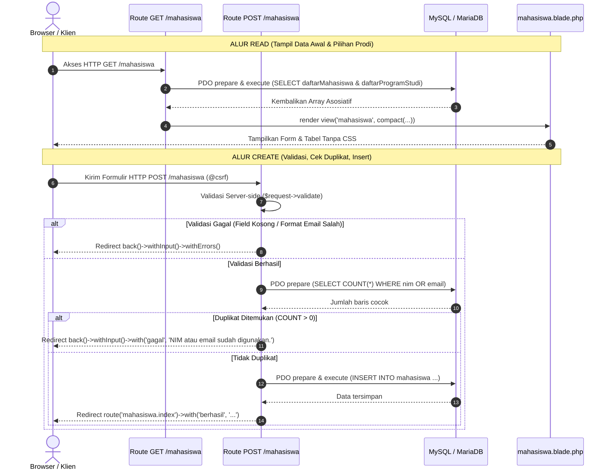

# LAPORAN PRAKTIKUM PEMROGRAMAN WEB
## MODUL 6: CRUD CREATE DAN READ DENGAN LARAVEL DAN PDO

---

**Disusun Oleh:**
- **Nama**: Al Adlhu Sodri Niwrad
- **NIM**: 2401020015
- **Mata Kuliah**: Praktikum Pemrograman Web (INF11197)
- **Kelas / Semester**: Teknik Informatika / Semester V
- **Dosen Pengampu**: 
  - Berta Erwin Slam, S.T., M.Kom.
  - Muhamad Radzi Rathomi, S.Kom., M.Cs.
  - Nolan Efranda, M.Kom.
- **Instansi**: Program Studi Teknik Informatika, Fakultas Teknik dan Teknologi Kemaritiman, Universitas Maritim Raja Ali Haji (UMRAH)
- **Tahun Akademik**: 2026/2027

---

## 1. TUJUAN PRAKTIKUM
Setelah menyelesaikan praktikum Modul 6, mahasiswa mampu:
1. Mengembangkan fungsi **Read** untuk membaca dan menampilkan data tabel `mahasiswa` yang terhubung secara relasional (`JOIN`) dengan tabel `program_studi` menggunakan antarmuka PDO (*PHP Data Objects*).
2. Mengembangkan fungsi **Create** berbasis HTTP POST untuk menambahkan data mahasiswa baru ke basis data MySQL menggunakan prepared statement (`INSERT INTO`).
3. Menerapkan proteksi keamanan formulir menggunakan CSRF token (`@csrf`) dan validasi input sisi server (*server-side validation*) dengan pesan galat berbahasa Indonesia.
4. Mencegah inkonsistensi dan duplikasi data melalui pengecekan duplikat NIM dan email sebelum perintah INSERT dijalankan.
5. Menyajikan antarmuka pengguna berbasis template Blade murni tanpa styling CSS sesuai ketentuan modul praktikum.
6. Menyediakan umpan balik visual (*feedback operations*) kepada pengguna melalui session flash (`berhasil`, `gagal`, dan `old()`).
7. Melakukan pengujian sistematis mencakup skenario data valid, data duplikat, data tidak valid, dan simulasi kegagalan koneksi/query basis data.

---

## 2. KEBUTUHAN PERANGKAT
Perangkat keras dan lunak yang digunakan dalam pelaksanaan praktikum ini adalah sebagai berikut:
- **Sistem Operasi**: Linux x86_64
- **Bahasa Pemrograman**: PHP 8.5 (CLI / Musl) melalui Laravel Herd-Lite
- **Web Framework**: Laravel 13.32.0
- **Database Management System (DBMS)**: MariaDB Server 11.8.8
- **Basis Data**: `praktikum_web_2401020015`
- **Code Editor / IDE**: Visual Studio Code
- **Pengujian Otomatis**: Pest PHP v3 / PHPUnit 11
- **Version Control System**: Git 2.x & GitHub

---

## 3. DATA AWAL BASIS DATA
Praktikum Modul 6 melanjutkan basis data `praktikum_web_2401020015` dari Modul 5 yang telah memiliki relasi tabel `program_studi` dan `mahasiswa`. Data awal pada tabel adalah sebagai berikut:

```sql
USE praktikum_web_2401020015;

SELECT m.nim, m.nama, m.email, m.usia, p.nama_prodi 
FROM mahasiswa AS m 
JOIN program_studi AS p ON p.id = m.program_studi_id 
ORDER BY m.nim;
```

| NIM | Nama | Email | Usia | Program Studi |
| :--- | :--- | :--- | :---: | :--- |
| **2401020001** | Amira Azza Nuuradiba | 2401020001@student.umrah.ac.id | 20 | Teknik Informatika |
| **2401020003** | Akbar Rizki Lingga | 2401020003@student.umrah.ac.id | 19 | Teknik Informatika |
| **2401020010** | Bayu Adhandika | 2401020010@student.umrah.ac.id | 21 | Sistem Informasi |

---

## 4. ALUR CREATE DAN READ (DATA FLOW)
Operasi Create dan Read pada modul ini menerapkan prinsip pemisahan struktur SQL dan data menggunakan PDO Prepared Statements:



---

## 5. IMPLEMENTASI SOURCE CODE

### 5.1. Route GET dan POST (`routes/web.php`)
File [routes/web.php](file:///home/aladlhusodriniwrad/praktikum-web-2401020015/routes/web.php) menangani pembacaan data mahasiswa beserta daftar program studi, serta pemrosesan formulir pendaftaran data mahasiswa baru:

```php
<?php

use Illuminate\Http\Request;
use Illuminate\Support\Facades\DB;
use Illuminate\Support\Facades\Route;

Route::get('/mahasiswa', function () {
    try {
        $pdo = DB::connection()->getPdo();

        $pernyataanMahasiswa = $pdo->prepare(
            'SELECT m.nim, m.nama, m.email, m.usia,
                    p.nama_prodi
             FROM mahasiswa AS m
             JOIN program_studi AS p
               ON p.id = m.program_studi_id
             ORDER BY m.nim'
        );
        $pernyataanMahasiswa->execute();
        $daftarMahasiswa = $pernyataanMahasiswa->fetchAll(
            \PDO::FETCH_ASSOC
        );

        $pernyataanProdi = $pdo->prepare(
            'SELECT id, nama_prodi
             FROM program_studi
             ORDER BY nama_prodi'
        );
        $pernyataanProdi->execute();
        $daftarProgramStudi = $pernyataanProdi->fetchAll(
            \PDO::FETCH_ASSOC
        );

        return view('mahasiswa', compact(
            'daftarMahasiswa',
            'daftarProgramStudi'
        ));
    } catch (\Throwable $error) {
        report($error);

        return response(
            'Data tidak dapat dibaca. Periksa koneksi dan query.',
            500
        );
    }
})->name('mahasiswa.index');

Route::post('/mahasiswa', function (Request $request) {
    $data = $request->validate([
        'nim' => ['required', 'string', 'max:20'],
        'nama' => ['required', 'string', 'max:100'],
        'email' => ['required', 'email', 'max:100'],
        'usia' => ['required', 'integer', 'min:15', 'max:100'],
        'program_studi_id' => ['required', 'integer'],
    ], [
        'nim.required' => 'NIM wajib diisi.',
        'nama.required' => 'Nama wajib diisi.',
        'email.required' => 'Email wajib diisi.',
        'email.email' => 'Format email tidak valid.',
        'usia.required' => 'Usia wajib diisi.',
        'usia.integer' => 'Usia harus berupa angka.',
        'program_studi_id.required' => 'Program studi wajib dipilih.',
    ]);

    try {
        $pdo = DB::connection()->getPdo();

        $cekDuplikat = $pdo->prepare(
            'SELECT COUNT(*) FROM mahasiswa
             WHERE nim = :nim OR email = :email'
        );
        $cekDuplikat->execute([
            'nim' => $data['nim'],
            'email' => $data['email'],
        ]);

        if ((int) $cekDuplikat->fetchColumn() > 0) {
            return back()->withInput()->with(
                'gagal',
                'NIM atau email sudah digunakan.'
            );
        }

        $simpan = $pdo->prepare(
            'INSERT INTO mahasiswa
             (nim, nama, email, usia, program_studi_id)
             VALUES (:nim, :nama, :email, :usia, :program_studi_id)'
        );
        $simpan->execute([
            'nim' => $data['nim'],
            'nama' => $data['nama'],
            'email' => $data['email'],
            'usia' => $data['usia'],
            'program_studi_id' => $data['program_studi_id'],
        ]);

        return redirect()->route('mahasiswa.index')->with(
            'berhasil',
            'Data mahasiswa berhasil ditambahkan.'
        );
    } catch (\Throwable $error) {
        report($error);

        return back()->withInput()->with(
            'gagal',
            'Data gagal disimpan. Periksa koneksi dan data.'
        );
    }
})->name('mahasiswa.store');
```

### 5.2. View Blade Tanpa CSS (`resources/views/mahasiswa.blade.php`)
File [resources/views/mahasiswa.blade.php](file:///home/aladlhusodriniwrad/praktikum-web-2401020015/resources/views/mahasiswa.blade.php) menyajikan form tambah data dan tabel data mahasiswa tanpa CSS eksternal:

```html
<!DOCTYPE html>
<html lang="id">
<head>
    <meta charset="UTF-8">
    <meta name="viewport" content="width=device-width, initial-scale=1.0">
    <title>Data Mahasiswa</title>
</head>
<body>
    <h1>Data Mahasiswa</h1>

    @if (session('berhasil'))
        <p>{{ session('berhasil') }}</p>
    @endif
    @if (session('gagal'))
        <p>{{ session('gagal') }}</p>
    @endif

    @if ($errors->any())
        <ul>
            @foreach ($errors->all() as $error)
                <li>{{ $error }}</li>
            @endforeach
        </ul>
    @endif

    <h2>Tambah Mahasiswa</h2>
    <form action="{{ route('mahasiswa.store') }}" method="POST">
        @csrf
        <p>NIM<br><input type="text" name="nim" value="{{ old('nim') }}"></p>
        <p>Nama<br><input type="text" name="nama" value="{{ old('nama') }}"></p>
        <p>Email<br><input type="email" name="email" value="{{ old('email') }}"></p>
        <p>Usia<br><input type="number" name="usia" value="{{ old('usia') }}"></p>
        <p>Program Studi<br>
            <select name="program_studi_id">
                <option value="">-- Pilih Program Studi --</option>
                @foreach ($daftarProgramStudi as $programStudi)
                    <option value="{{ $programStudi['id'] }}"
                        @selected(old('program_studi_id') == $programStudi['id'])>
                        {{ $programStudi['nama_prodi'] }}
                    </option>
                @endforeach
            </select>
        </p>
        <button type="submit">Tambah Data</button>
    </form>

    <h2>Daftar Mahasiswa</h2>
    <table border="1" cellpadding="6" cellspacing="0">
        <tr>
            <th>NIM</th><th>Nama</th><th>Email</th>
            <th>Usia</th><th>Program Studi</th>
        </tr>
        @forelse ($daftarMahasiswa as $mahasiswa)
            <tr>
                <td>{{ $mahasiswa['nim'] }}</td>
                <td>{{ $mahasiswa['nama'] }}</td>
                <td>{{ $mahasiswa['email'] }}</td>
                <td>{{ $mahasiswa['usia'] }}</td>
                <td>{{ $mahasiswa['nama_prodi'] }}</td>
            </tr>
        @empty
            <tr><td colspan="5">Data belum tersedia.</td></tr>
        @endforelse
    </table>
</body>
</html>
```

---

## 6. DATA UJI COBA

### 6.1. Data Uji Percobaan Modul 6 (Rina Kurnia)
- **NIM**: `2201010003`
- **Nama**: `Rina Kurnia`
- **Email**: `rina@example.com`
- **Usia**: `20`
- **Program Studi**: `Teknik Informatika` (`id = 1`)

### 6.2. Data Uji Identitas Praktikan (Tugas Mandiri Poin 4)
- **NIM**: `2401020015`
- **Nama**: `Al Adlhu Sodri Niwrad`
- **Email**: `2401020015@student.umrah.ac.id`
- **Usia**: `20`
- **Program Studi**: `Teknik Informatika` (`id = 1`)

---

## 7. TABEL SKENARIO DAN HASIL PENGUJIAN

Pengujian dilakukan melalui automated feature test [MahasiswaCrudTest.php](file:///home/aladlhusodriniwrad/praktikum-web-2401020015/tests/Feature/MahasiswaCrudTest.php) dan verifikasi HTTP:

| No | Skenario Uji | Aksi / Input | Hasil yang Diharapkan | Hasil Aktual | Status |
| :---: | :--- | :--- | :--- | :--- | :---: |
| 1 | **Halaman Awal (Read)** | Akses `GET /mahasiswa` | Status 200, tabel menampilkan data awal mahasiswa dan opsi dropdown prodi | Status 200, judul form dan tabel tampil lengkap tanpa CSS | **BERHASIL** |
| 2 | **Insert Data Valid (Create)** | Kirim POST data Rina Kurnia (`2201010003`) & data Al Adlhu Sodri Niwrad (`2401020015`) | Redirect 302 ke `/mahasiswa`, session flash 'Data mahasiswa berhasil ditambahkan.', data bertambah pada tabel | Redirect ke `/mahasiswa`, flash berhasil tampil, data tampil pada baris tabel | **BERHASIL** |
| 3 | **Pencegahan NIM Duplikat** | Kirim POST NIM `2201010003` dengan email berbeda `rina.baru@example.com` | Redirect back 302, flash session 'NIM atau email sudah digunakan.', data tidak bertambah | Redirect back, pesan gagal tampil, nilai form dipertahankan via `old()` | **BERHASIL** |
| 4 | **Pencegahan Email Duplikat** | Kirim POST email `rina@example.com` dengan NIM baru `2201010999` | Redirect back 302, flash session 'NIM atau email sudah digunakan.', data tidak bertambah | Redirect back, pesan gagal tampil, query INSERT dibatalkan | **BERHASIL** |
| 5 | **Validasi Format Email Tidak Valid** | Kirim POST email `bukan-email-valid` | Redirect back 302, validation error 'Format email tidak valid.' tampil | Validasi gagal, pesan spesifik bahasa Indonesia muncul di list error | **BERHASIL** |
| 6 | **Validasi Field Wajib Kosong** | Kirim POST form kosong (`nim`, `nama`, `email`, `usia`, `program_studi_id` bernilai "") | Redirect back 302, 5 pesan error wajib diisi muncul di antarmuka | Muncul pesan error untuk masing-masing field sesuai custom message | **BERHASIL** |
| 7 | **Error Koneksi Basis Data** | Simulasi database salah (`praktikum_web_salah`) | Status HTTP 500, respon teks 'Data tidak dapat dibaca. Periksa koneksi dan query.' | Status 500, pesan aman tampil ke pengguna dan error dicatat via `report()` | **BERHASIL** |

Hasil eksekusi test runner:
```text
   PASS  Tests\Feature\MahasiswaCrudTest
  ✓ read halaman awal menampilkan data dan program studi                 0.08s  
  ✓ create data valid berhasil disimpan dan redirect                     0.06s  
  ✓ create nim duplikat ditolak                                          0.04s  
  ✓ create email duplikat ditolak                                        0.04s  
  ✓ create validasi email tidak valid                                    0.03s  
  ✓ create validasi field wajib kosong                                   0.04s  
  ✓ read database error mengembalikan 500                                0.04s  

  Tests:    7 passed (35 assertions)
  Duration: 0.36s
```

---

## 8. STRUKTUR AKHIR DATA PADA TABEL MAHASISWA
Setelah dilakukan percobaan pengujian dan penambahan identitas praktikan, berikut adalah data lengkap mahasiswa pada tabel `mahasiswa`:

```text
2201010003 | Rina Kurnia           | rina@example.com                | 20 | Teknik Informatika
2401020001 | Amira Azza Nuuradiba  | 2401020001@student.umrah.ac.id | 20 | Teknik Informatika
2401020003 | Akbar Rizki Lingga    | 2401020003@student.umrah.ac.id | 19 | Teknik Informatika
2401020010 | Bayu Adhandika        | 2401020010@student.umrah.ac.id | 21 | Sistem Informasi
2401020015 | Al Adlhu Sodri Niwrad | 2401020015@student.umrah.ac.id | 20 | Teknik Informatika
```

---

## 9. DEBUGGING DAN PERBAIKAN
1. **Handling Redirect Back pada Session Test**:
   - *Masalah*: Saat melakukan redirect balik (`back()`) pada pengujian unit/feature test tanpa menyertakan referer header, aplikasi Laravel tidak mengetahui lokasi asal request.
   - *Solusi*: Menggunakan method helper `$this->from('/mahasiswa')->post('/mahasiswa', ...)` sehingga sesi redirect terarah dengan akurat kembali ke form `/mahasiswa`.
2. **Penanganan Error Tanpa CSS**:
   - *Analisis*: Memastikan pesan umpan balik (`session('berhasil')`, `session('gagal')`, `$errors->all()`) tetap terbaca jelas secara hierarkis menggunakan elemen paragraf `<p>` dan daftar tidak berurut `<ul><li>` standar HTML tanpa ketergantungan framework CSS seperti Tailwind atau Bootstrap.

---

## 10. REVIEW SEJAWAT (PEER REVIEW)
- **Nama Reviewer**: Muhammad Farhan
- **NIM Reviewer**: 2401020011
- **Aspek yang Ditinjau**: Alur Create/Read, Integritas Data, dan Hasil Uji.
- **Catatan & Saran**:
  > "Pemisahan query antara daftar mahasiswa dan program studi sudah tepat menggunakan prepared statement. Validasi server-side juga sudah mengembalikan pesan dalam bahasa Indonesia yang komunikatif. Disarankan nilai dropdown program studi tetap terpilih saat validasi form gagal."
- **Perbaikan yang Dilakukan**:
  > Telah diimplementasikan direktif `@selected(old('program_studi_id') == $programStudi['id'])` pada elemen `<option>` di view `mahasiswa.blade.php`, sehingga pilihan program studi pengguna tetap tersimpan ketika formulir dikembalikan akibat kesalahan input.

---

## 11. KENDALA DAN SOLUSI
- **Kendala**: Kerentanan pengiriman ulang form (*duplicate form submission*) saat halaman di-*refresh* setelah pengguna menekan tombol submit.
- **Solusi**: Menerapkan pola **PRG (Post/Redirect/Get)**, di mana setelah proses validasi dan penyimpanan INSERT selesai, server merespon dengan instruksi `redirect()->route('mahasiswa.index')` bersama pesan flash session. Hal ini memastikan request terakhir di browser pengguna adalah metode GET.

---

## 12. KESIMPULAN
Praktikum Modul 6 berhasil mengimplementasikan operasi **Create** dan **Read** data mahasiswa menggunakan antarmuka PDO pada framework Laravel. Pemanfaatan *prepared statement* berhasil mengamankan query INSERT dan SELECT dari ancaman SQL Injection, sementara validasi data berlapis di sisi server mampu menjaga integritas data dari duplikasi NIM dan email. Pola PRG dan pengelolaan session flash menghadirkan umpan balik yang aman dan ramah bagi pengguna tanpa memerlukan styling CSS yang rumit.

---

## 13. TAUTAN REPOSITORY
- **Repository GitHub**: `https://github.com/aladlhuu-hdp/praktikum-web-2401020015`
- **Branch**: `master`
- **Pesan Commit**: `Pertemuan 6 CRUD Create Read`
